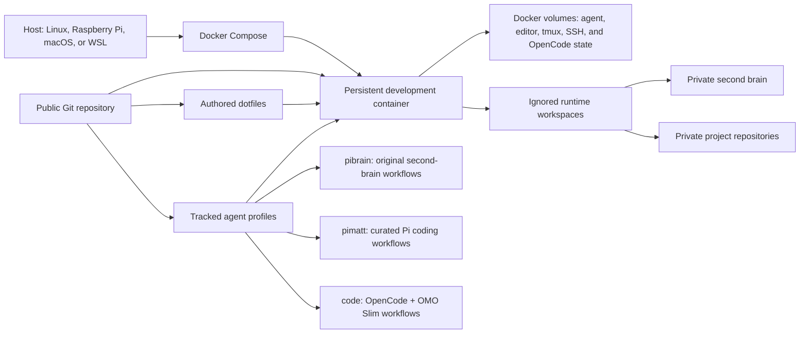

# Portable Agentic Development Environment

My personal, containerized workstation for software development, coding agents, and a durable second brain.

I built this project because I want the same environment on every machine I use: clone the repository, start Docker, and continue working. It combines my terminal and editor configuration with agent profiles, persistent tool state, and smoke-tested safety boundaries. Private repositories and knowledge remain in ignored workspaces that I manage explicitly.

It is also an inspectable record of how I approach agentic engineering: I build workflows where agents use tools, retrieve durable context, verify their work, and ask for approval before changing important knowledge.

## What is original and what is adapted

Good agentic work includes knowing when to build and when to adapt. This repository contains both, with provenance kept explicit.

| Component | Purpose | Provenance |
| --- | --- | --- |
| Docker environment and runtime workspaces | Reproduce the workstation while keeping private repositories and knowledge outside the public repository | Designed and developed by me |
| Neovim, tmux, and shell configuration | Provide my portable terminal development workflow | Configured and maintained by me, using third-party tools and plugins |
| [`pibrain`](agent_profiles/pibrain/) | Operate and learn from a private PARA second brain | Original second-brain workflows developed by me with agent assistance; selected utility skills retained from Matt Pocock with attribution |
| [`pimatt`](agent_profiles/pimatt/) | Provide general software-engineering workflows | Primarily curated from [Matt Pocock's skills](https://github.com/mattpocock/skills), with local integration and explicit attribution |
| [`code`](agent_profiles/code/) | Run OpenCode with oh-my-opencode-slim orchestration | Profile integration and local workflows are tracked here; selected Matt Pocock skills are bundled with attribution |
| [`ecc`](agent_profiles/ecc/) | Run OpenCode with Everything Claude Code's native OpenCode catalog and plugin | Isolated profile integration with pinned upstream assets and attribution |
| [`openbrain`](agent_profiles/openbrain/) | Run OpenCode for second-brain work with isolated profile state | Profile integration and curated workflows are tracked here with upstream attribution |

Skills copied into `pibrain`, `pimatt`, and `code` retain their upstream license, source path, and content hash under the applicable profile.

## Original-work highlight: `pibrain`

`pibrain` is a Pi profile I designed for working with a long-lived private knowledge base without treating every generated statement as truth or silently rewriting established knowledge.

Its skills cover:

- source ingestion with duplicate detection and approval before writes;
- reconciliation of user-confirmed corrections and changed state;
- indexed vault queries with citations and explicit uncertainty;
- safe creation, movement, merging, and archival of primary pages;
- read-only linting before user-selected repairs;
- adaptive learning grounded in confirmed context and evidence.

### Adaptive learning workflow

The [`second-brain-learn`](agent_profiles/pibrain/skills/.agents/skills/second-brain-learn/SKILL.md) skill is based on two ideas:

- the PARA organization method from Tiago Forte's *[Building a Second Brain](https://www.buildingasecondbrain.com/book)*;
- the learning process shown in Eero Alvar's *[How I Use AI to Learn Things](https://www.youtube.com/watch?v=kzcI5F4tGiU)*.

I developed those ideas into a stateful agent workflow that:

1. defines an observable learning goal;
2. retrieves only user-confirmed private context;
3. probes current understanding;
4. builds and verifies a dependency-aware learning path;
5. teaches and adapts based on demonstrated understanding;
6. separates evidence quality from quiz performance;
7. exposes conflicting evidence instead of silently choosing a side;
8. proposes knowledge, learner-state, and teaching-profile updates separately;
9. persists only explicitly approved changes;
10. runs a final read-only vault health check.

This is the kind of agentic work I am interested in: not a single clever prompt, but a bounded process with state, tools, evidence, feedback, and human control.

## Architecture



The public repository contains the environment and workflow definitions. Private knowledge and active project checkouts remain in ignored runtime paths and are never cloned or synchronized automatically. At startup, Graphify installs its Pi integration into the persistent agent volume and its OpenCode skill into the `code` profile.

## Design requirements

- **Portable:** support 64-bit x86 and ARM Docker hosts.
- **Reproducible:** install the same shell, editor, agent, and supporting tools from the Dockerfile.
- **Persistent:** retain generated Pi, Neovim, and tmux state in Docker volumes.
- **Inspectable:** keep authored configuration, skills, and integration code in Git.
- **Private by default:** exclude runtime projects and the second brain from the public repository.
- **Conservative startup:** never clone or synchronize private repositories automatically.
- **Failure tolerant:** keep the core environment usable without provider credentials; report optional services as unconfigured.
- **Human controlled:** require approval before agent workflows persist consequential knowledge changes.

## Quick start

### Prerequisites

- Docker Engine and Docker Compose
- Git

Private-remote access is needed only for repositories you choose to clone into the ignored workspaces.

Start the environment from the repository root:

```sh
docker compose up --build --detach
docker compose exec pi bash
```

Authenticate GitHub CLI inside the container when needed:

```sh
gh auth login
# For GitHub Enterprise, specify your host:
gh auth login --hostname github.example.com
```

GitHub CLI configuration, including sensitive credentials, is stored in the dedicated `gh-config` Docker named volume. It persists across container recreation, but is not an encrypted vault; never commit its contents or a backup. `docker compose down --volumes` deletes this volume and its credentials.

If upgrading an already-authenticated container, its existing login is not migrated automatically. Before recreating it, either back up the config and restore it after startup, or simply run `gh auth login` again in the new container. To preserve the existing login, run from the repository root before recreation:

```sh
umask 077
backup=$(mktemp -d "${TMPDIR:-/tmp}/pi-agent-gh.XXXXXX")
docker cp "$(docker compose ps -q pi):/root/.config/gh/." "$backup/"
docker compose up --build --detach
docker cp "$backup/." "$(docker compose ps -q pi):/root/.config/gh/"
docker compose exec pi gh auth status
rm -rf "$backup"
```

The backup contains credentials; keep it outside the checkout, never commit it, and remove it after confirming authentication works.

The checkout is mounted at `/pi_agent`. Start the appropriate profile inside the container:

```sh
# Pi coding session
cd /pi_agent/workspaces/projects/<repository>
pimatt

# OpenCode coding session
cd /pi_agent/workspaces/projects/<repository>
code

# OpenCode with ECC (separate configuration, credentials, and state)
ecc

# Second-brain session
cd /pi_agent/workspaces/second_brain
pibrain
```

Stop the environment without deleting persistent volumes:

```sh
docker compose down
```

## Optional local configuration

Copy the example environment file and set only what the current machine needs:

```sh
cp .env.example .env
```

Available settings include provider credentials and Git author identity. Every entry in `.env` is forwarded to the `pi` container, so a new credential needs no `compose.yaml` change. `.env` is ignored by Git, it is optional, and the container starts without provider credentials when it is absent.

## Portability and verification

I use this environment on:

- Linux on x86-64;
- Raspberry Pi on 64-bit ARM;
- macOS through Docker;
- Windows through WSL.

The Docker image explicitly supports `amd64` and `arm64`. Run the offline fast checks from any working directory with Bash, Python 3, and Node.js installed:

```sh
bash /path/to/pi_agent/tests/check-fast.sh
```

This checks syntax for repo-owned launchers and smoke scripts, the code profile, ECC, OpenBrain, Graphify, and no-voice integration smoke tests. It does not install dependencies or require Docker or network access. GitHub Actions runs these checks on pushes and pull requests; secret scanning remains separate.

The Linux end-to-end Docker smoke test remains a separate local check:

```sh
tests/compose-smoke.sh
```

It verifies startup without provider credentials, profile discovery, configuration symlinks, and Pi/OpenCode availability.

## License and attribution

My original work in this repository is available under the [MIT License](LICENSE). Third-party tools, plugins, and bundled material remain subject to their own licenses.

The ECC profile bundles material from [affaan-m/ECC](https://github.com/affaan-m/ECC) under its upstream MIT license. Its pinned source, license, and asset provenance are recorded under `agent_profiles/ecc/`.

The skills copied from [`mattpocock/skills`](https://github.com/mattpocock/skills) for `pibrain`, `pimatt`, and `code` retain their MIT license and provenance records under the applicable profile's `LICENSES/` or `skills/LICENSES/` directory and `skills-lock.json` file.

The LangChain and LangSmith skills bundled with `code` are copied from MIT-licensed upstream revisions. Their license text and pinned source revisions are recorded in `agent_profiles/code/LICENSES/`.

The Karpathy guidelines bundled with `code` retain their upstream MIT declaration. Their pinned source and attribution are recorded in `agent_profiles/code/LICENSES/andrej-karpathy-skills-NOTICE.txt`.

The Caveman skill/content © 2026 Julius Brussee is licensed under the MIT License. Its notice and provenance record are under `agent_profiles/code/LICENSES/` and `agent_profiles/code/opencode/skills-lock.json`.
